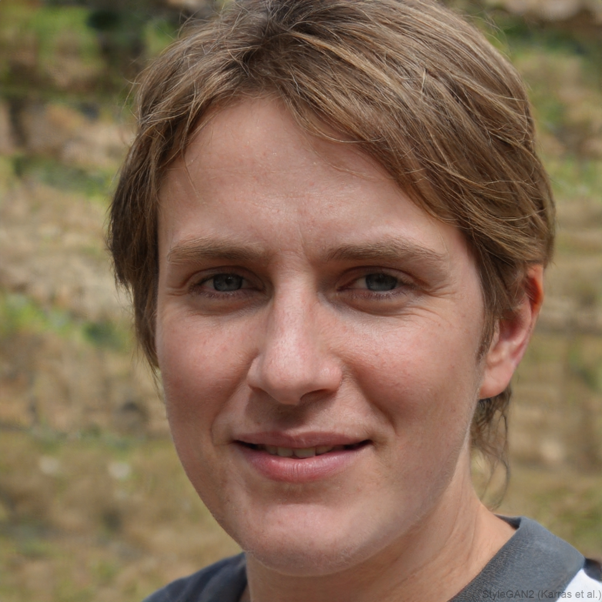
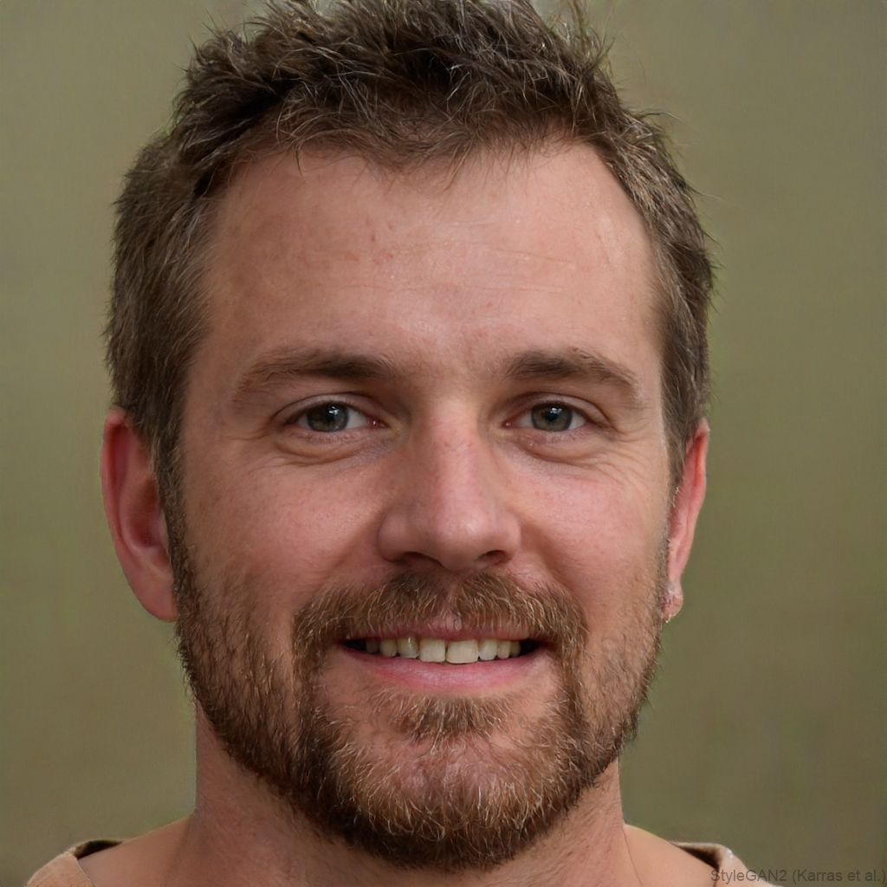

# Personas — Sistema de Gestão e Acompanhamento de Treinos em Academias

> **Nota metodológica:** As personas abaixo representam perfis fictícios construídos a partir de necessidades e comportamentos identificados na pesquisa. Os nomes, as idades e as ocupações são ilustrativos, pois essas informações não foram coletadas no questionário. As características específicas de cada perfil deverão ser validadas com novas entrevistas.

## 1. Persona Primária I: Lucas Ferreira

| Campo | Descrição |
| :--- | :--- |
| **Tipo de Persona** | Primária — praticante regular que prioriza agilidade e organização dos treinos. |
| **Idade** | 24 anos (ilustrativa). |
| **Ocupação** | Analista Júnior / Estudante (ilustrativa). |
| **Citação** | "Quero encontrar meu treino rapidamente e registrar as cargas sem interromper meu ritmo." |
| **Familiaridade com tecnologia** | A validar. Utiliza ou conhece alternativas digitais de registro, mas seu nível de domínio tecnológico não foi medido na pesquisa. |
| **Objetivos** | Consultar o treino do dia rapidamente; registrar exercícios, séries, repetições e cargas; consultar o histórico; acompanhar a evolução ao longo do tempo. |
| **Frustração principal** | Esquecer exercícios ou cargas, perder tempo registrando informações e depender de aplicativos que apresentam falhas, limitações ou funcionalidades pagas. |

### Mapa de Empatia — Lucas Ferreira

| Quadrante | Descrição |
| :--- | :--- |
| **O que vê** | Academia movimentada, equipamentos ocupados e diferentes formas de consultar os treinos, como aplicativos, anotações e memória. |
| **O que ouve** | Comentários sobre progressão de cargas, organização dos exercícios e dificuldades relacionadas à disponibilidade de aparelhos. |
| **O que diz e faz** | Treina regularmente, consulta informações sobre os exercícios e procura registrar o que realizou. Pode alterar a ordem das atividades quando um equipamento está ocupado. |
| **O que pensa e sente** | Deseja manter a constância e perceber resultados sem transformar o registro em uma tarefa demorada. |
| **Dores** | Esquecimento dos exercícios; dificuldade para lembrar as cargas utilizadas; registro demorado; perda de informações ou falhas na atualização do treino. |
| **Ganhos** | Acesso rápido ao treino do dia, registro simples, histórico confiável e visualização clara da evolução. |

---

## 2. Persona Primária II: Mariana Alves

| Campo | Descrição |
| :--- | :--- |
| **Tipo de Persona** | Primária — praticante em fase de consolidação da rotina de treinos. |
| **Idade** | 26 anos (ilustrativa). |
| **Ocupação** | Assistente Administrativa (ilustrativa). |
| **Citação** | "Quero saber quais exercícios preciso fazer e acompanhar meu progresso sem complicar minha rotina." |
| **Familiaridade com tecnologia** | A validar. O questionário identificou diferentes formas de organizar os treinos, mas não mediu diretamente a familiaridade tecnológica. |
| **Objetivos** | Organizar os exercícios; consultar séries e repetições; compreender as informações do treino; manter uma rotina consistente e acompanhar os resultados. |
| **Frustração principal** | Ter dificuldade para lembrar os exercícios, encontrar orientações claras e registrar as atividades quando está com pouco tempo. |

### Mapa de Empatia — Mariana Alves

| Quadrante | Descrição |
| :--- | :--- |
| **O que vê** | Diferentes equipamentos, fichas de treino, aplicativos e praticantes com níveis variados de experiência. |
| **O que ouve** | Orientações sobre execução dos movimentos, aquecimento, descanso e importância da regularidade nos treinos. |
| **O que diz e faz** | Procura consultar as informações dos exercícios e organizar as atividades, recorrendo a anotações, aplicativos ou ajuda de outras pessoas quando necessário. |
| **O que pensa e sente** | Quer compreender o que precisa fazer e ter segurança para seguir o treino sem depender de informações difíceis de encontrar. |
| **Dores** | Dúvidas sobre os exercícios; esquecimento da ordem das atividades; dificuldade para encontrar informações sobre execução, aquecimento e descanso. |
| **Ganhos** | Interface clara, sequência organizada de exercícios, informações fáceis de consultar e histórico que permita visualizar o progresso. |

**Observação:** as necessidades relacionadas à execução dos movimentos e ao descanso apareceram nas respostas, mas devem ser investigadas com mais participantes. Por isso, recursos como vídeos explicativos e temporizadores são possibilidades a validar, e não requisitos definitivos.

---

## 3. Persona Secundária: André Costa

| Campo | Descrição |
| :--- | :--- |
| **Tipo de Persona** | Secundária — praticante experiente e autônomo. |
| **Idade** | 31 anos (ilustrativa). |
| **Ocupação** | Engenheiro de Software (ilustrativa). |
| **Citação** | "Quero acompanhar minha evolução e adaptar meu treino quando for necessário, sem perder meu histórico." |
| **Familiaridade com tecnologia** | A validar. A experiência avançada com aplicativos e ferramentas de registro é uma hipótese desse perfil, não uma conclusão da pesquisa. |
| **Objetivos** | Registrar parâmetros dos exercícios; consultar cargas anteriores; comparar o desempenho entre sessões; organizar e adaptar os treinos conforme as necessidades. |
| **Frustração principal** | Perder registros de evolução, encontrar limitações para editar o treino e não conseguir consultar facilmente as informações acumuladas. |

### Mapa de Empatia — André Costa

| Quadrante | Descrição |
| :--- | :--- |
| **O que vê** | Aplicativos de acompanhamento, registros anteriores e situações em que é necessário adaptar a sequência dos exercícios. |
| **O que ouve** | Conversas sobre progressão de carga, organização dos treinos, volume de exercícios e acompanhamento de resultados. |
| **O que diz e faz** | Mantém uma rotina de exercícios, utiliza informações anteriores para orientar as sessões e procura adaptar as atividades quando necessário. |
| **O que pensa e sente** | Valoriza a autonomia para organizar os exercícios e deseja ter acesso aos próprios dados sem perder flexibilidade. |
| **Dores** | Histórico incompleto, dificuldade para comparar cargas e limitações na organização ou alteração dos exercícios. |
| **Ganhos** | Histórico detalhado, gráficos de evolução, edição dos treinos e facilidade para consultar informações anteriores. |

**Observação:** a pesquisa contou com apenas um participante identificado como atleta. Portanto, esse perfil deve continuar como persona secundária exploratória até que sejam coletadas mais respostas de praticantes experientes.

---

## 4. Resumo Comparativo das Personas

| Persona | Tipo | Necessidade principal | Prioridade para o sistema |
| :--- | :--- | :--- | :--- |
| **Lucas Ferreira** | Primária | Consultar e registrar o treino com rapidez. | Acesso ao treino do dia, registro de exercícios e cargas e histórico. |
| **Mariana Alves** | Primária | Organizar os exercícios e compreender as informações do treino. | Visualização clara dos exercícios, séries, repetições e progresso. |
| **André Costa** | Secundária | Acompanhar a evolução e manter autonomia sobre o treino. | Histórico detalhado, gráficos e flexibilidade de edição. |

## 5. Relação das Personas com a Pesquisa

A pesquisa realizada pelo grupo recebeu 14 respostas e revelou pontos importantes para orientar o desenvolvimento:

- **11 de 14 participantes (78,6%)** informaram que frequentam academia atualmente.
- **10 de 14 participantes (71,4%)** atribuíram nota 5, em uma escala de 1 a 5, à importância de visualizar rapidamente o treino do dia.
- **7 de 14 participantes (50%)** relataram utilizar principalmente a memória para consultar os exercícios, incluindo uma resposta que combina memorização com a escolha de equipamentos disponíveis.
- **7 de 14 participantes (50%)** afirmaram registrar os treinos sempre ou frequentemente.

Os resultados dão sustentação principalmente às necessidades de consulta rápida, registro e acompanhamento do histórico. Também foram relatadas dificuldades para lembrar exercícios e cargas, adaptar a ordem das atividades e encontrar informações claras.

As personas devem orientar a interface sem transformar todas as possibilidades em funcionalidades obrigatórias. O núcleo do sistema deve priorizar cadastro e organização dos treinos, registro de exercícios, dashboard de evolução e relatórios de progresso.

**Limitação da pesquisa:** os respondentes foram identificados como alunos ou atletas; não há representação específica de personal trainers na amostra. Caso esse público continue fazendo parte do escopo do projeto, será necessário entrevistá-lo para identificar suas necessidades de gerenciamento de múltiplos alunos.
