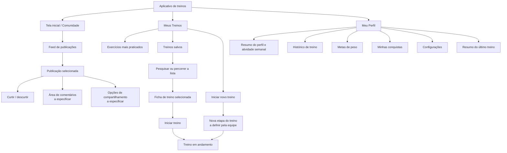
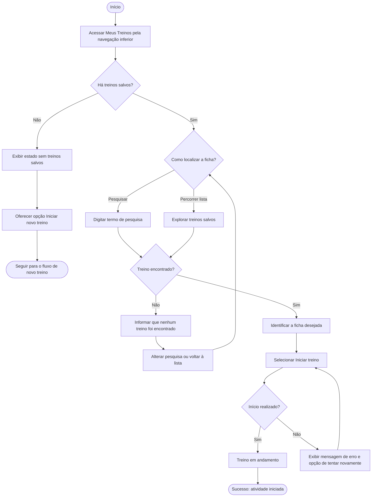
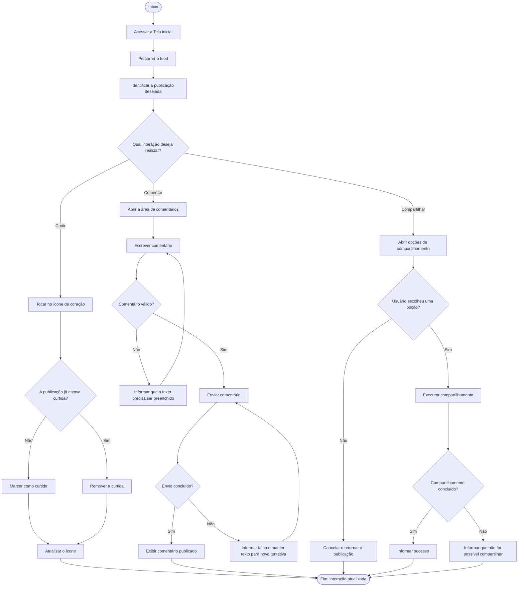
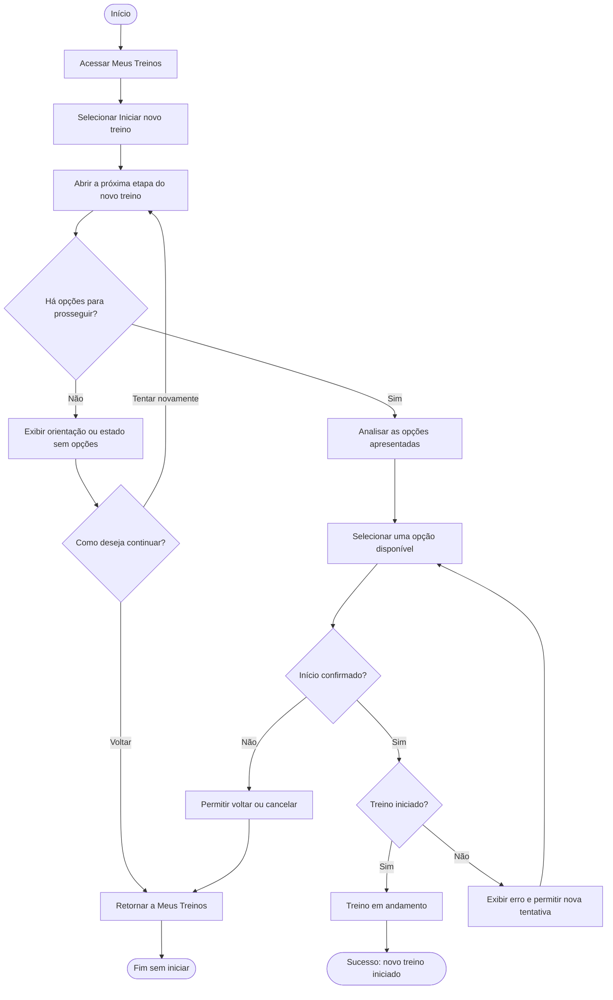
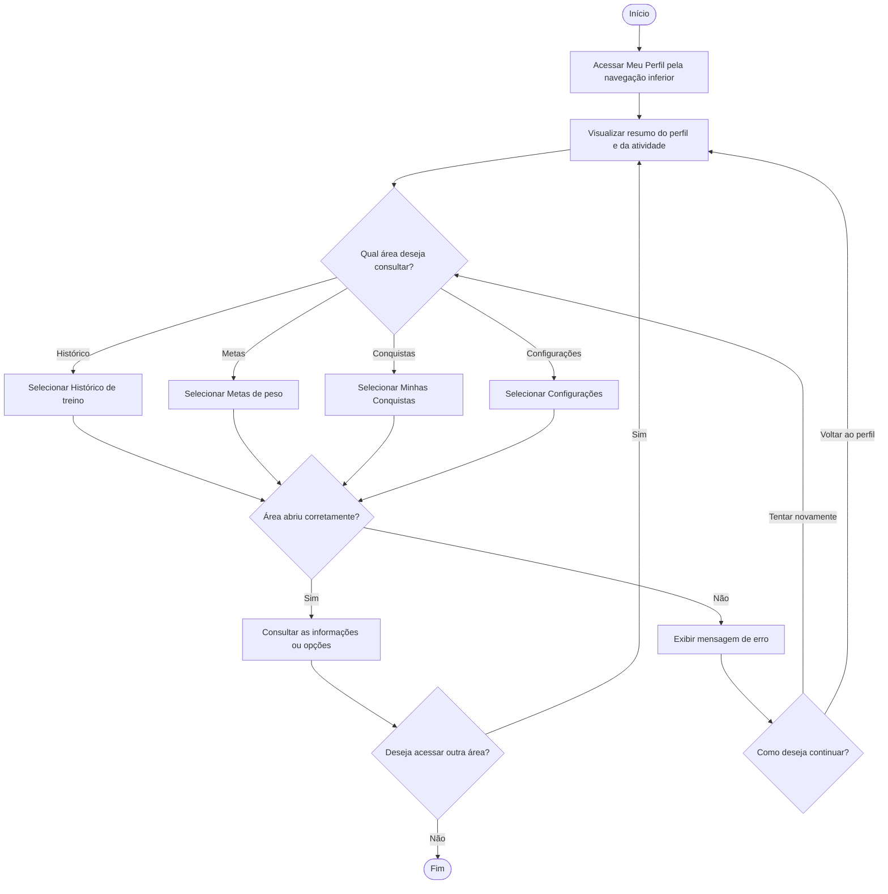

# Arquitetura de Informação e Fluxo do Usuário

**Produto:** Aplicativo de treinos  
**Etapa:** Organização da informação e definição dos principais caminhos de navegação

> **Nota de escopo:** os fluxos foram elaborados a partir das telas e funcionalidades descritas no protótipo e na análise de tarefas. Quando o comportamento de uma tela ainda não está definido, isso é indicado como proposta a validar pela equipe, e não como funcionalidade já existente.

---

## 1. Arquitetura da Informação — Sitemap

O sitemap organiza as telas por objetivo do usuário e mostra como elas se relacionam com a navegação principal do aplicativo.

### 1.1 Organização das telas

| Área principal | Conteúdo e funcionalidades | Objetivo do usuário |
|---|---|---|
| **Tela inicial / Comunidade** | Feed, publicações, curtidas, comentários e compartilhamentos | Acompanhar publicações e interagir com a comunidade |
| **Meus Treinos** | Exercícios mais praticados, treinos salvos, pesquisa e botão para iniciar um novo treino | Encontrar uma ficha ou começar uma atividade |
| **Treino em andamento** | Estado após iniciar um treino | Realizar a atividade iniciada. Os detalhes dessa tela devem seguir a especificação do produto |
| **Meu Perfil** | Informações do usuário, seguidores, pessoas seguidas, atividade semanal e último treino | Acompanhar informações pessoais e progresso |
| **Áreas do perfil** | Histórico, metas de peso, conquistas e configurações | Consultar registros ou acessar opções pessoais |

### 1.2 Justificativa da organização

A navegação foi dividida em três áreas principais — **Tela inicial**, **Meus Treinos** e **Meu Perfil** — para separar objetivos que são diferentes, mas complementares.

- **A Tela inicial** concentra a comunidade e as interações sociais, permitindo que o usuário veja publicações e escolha como interagir com elas.
- **Meus Treinos** reúne as ações ligadas à prática de exercícios. A lista de treinos salvos, a pesquisa e a opção de iniciar um novo treino diminuem o esforço para encontrar ou começar uma atividade.
- **Meu Perfil** centraliza informações pessoais e recursos de acompanhamento, como histórico, metas e conquistas, evitando distribuir esses conteúdos por diversas áreas.

Essa organização considera as necessidades descritas na análise de tarefas: encontrar treinos com facilidade, iniciar uma atividade, interagir com publicações e consultar o próprio progresso. A navegação inferior funciona como acesso direto às três áreas principais. A possibilidade de retornar à área anterior também deve ser mantida nas telas secundárias.

**Pontos que ainda precisam ser especificados:** o conteúdo da tela aberta por “Iniciar novo treino”, a interface para comentar e as opções exibidas ao compartilhar uma publicação não foram descritos integralmente no protótipo utilizado nesta análise.

---

## 2. Fluxos do Usuário — User Flows

Os diagramas abaixo representam os passos, decisões, caminhos alternativos e resultados esperados para quatro funcionalidades principais.

### 2.1 Iniciar um treino salvo

**Objetivo do usuário:** localizar uma ficha salva e iniciar sua execução sem precisar montar um treino novo.

**Caminho alternativo / atalho:** a pesquisa permite localizar uma ficha sem percorrer toda a lista. Se não houver treinos salvos, o usuário pode seguir para “Iniciar novo treino”.

**Estados de erro e sucesso:** quando a pesquisa não encontrar resultados, o aplicativo deve informar isso e permitir corrigir a busca. Se não for possível iniciar o treino, deve apresentar uma mensagem e oferecer nova tentativa. A tela de execução representa o resultado esperado; os detalhes dela precisam ser definidos na especificação do aplicativo.

### 2.2 Interagir com uma publicação

**Objetivo do usuário:** curtir, comentar ou compartilhar uma publicação da comunidade.

**Caminho alternativo / atalho:** o usuário escolhe diretamente o ícone da ação desejada na própria publicação; não precisa abrir uma tela separada para cada tipo de interação. O compartilhamento pode ser cancelado sem concluir a ação.

**Estados de erro e sucesso:** a curtida deve apresentar mudança visual. O comentário precisa validar o campo e comunicar se foi publicado ou se ocorreu uma falha. O compartilhamento deve permitir cancelar e apresentar o resultado da tentativa.

**A validar no protótipo:** a área de comentários, o seletor de compartilhamento e as mensagens de retorno são comportamentos propostos para completar o fluxo; não estão detalhados nas telas descritas.

### 2.3 Iniciar um novo treino

**Objetivo do usuário:** começar uma atividade sem selecionar uma ficha da lista de treinos salvos.

**Caminho alternativo / atalho:** o botão “Iniciar novo treino”, na tela “Meus Treinos”, é um caminho direto que dispensa a busca por uma ficha salva. O usuário também pode cancelar e retornar à lista.

**Estados de erro e sucesso:** o fluxo deve informar quando não houver opções para prosseguir, oferecer retorno e permitir nova tentativa se a inicialização falhar.

**Decisão pendente:** o protótipo descrito não especifica o que aparece depois do botão “Iniciar novo treino”. O diagrama representa o comportamento geral esperado, sem pressupor se a próxima etapa será uma sessão livre, a seleção de exercícios ou outra modalidade. A equipe precisa definir essa tela e suas opções antes da prototipação final.

### 2.4 Consultar opções do perfil

**Objetivo do usuário:** acessar uma área do perfil para consultar o histórico, as metas de peso, as conquistas ou as configurações.

**Caminho alternativo / atalho:** as opções do perfil ficam reunidas em uma única área. O usuário pode escolher diretamente a seção desejada e retornar ao perfil para acessar outra seção.

**Estados de erro e sucesso:** quando a área selecionada abrir, o usuário poderá consultar seu conteúdo. Se houver falha ao carregar, o aplicativo deve informar o problema e permitir tentar novamente ou retornar ao perfil.

---

## 3. Relação com as necessidades dos usuários

| Necessidade identificada na análise de tarefas | Decisão de arquitetura ou fluxo |
|---|---|
| Encontrar rapidamente uma ficha de treino | Agrupar treinos salvos em “Meus Treinos” e oferecer pesquisa e navegação pela lista |
| Começar uma atividade sem ficha salva | Disponibilizar o botão “Iniciar novo treino” na mesma área |
| Interagir com outras pessoas | Manter curtir, comentar e compartilhar diretamente nas publicações do feed |
| Consultar a própria atividade e informações pessoais | Agrupar resumo, histórico, metas, conquistas e configurações em “Meu Perfil” |
| Entender se uma ação foi concluída | Prever confirmações visuais, mensagens de sucesso e tratamento de erros nos fluxos |

A justificativa se baseia nas necessidades descritas na análise de tarefas fornecida. Se o relatório do questionário e as personas estiverem disponíveis, esta seção deve ser refinada com as necessidades específicas e os cenários correspondentes, evitando atribuir aos participantes conclusões que não foram documentadas.

## 4. Conclusão

A arquitetura organiza o aplicativo em três áreas principais — Tela inicial, Meus Treinos e Meu Perfil — e distribui as funcionalidades secundárias de acordo com os objetivos dos usuários. Os quatro fluxos detalham os caminhos para iniciar um treino salvo, interagir com uma publicação, iniciar um novo treino e consultar opções do perfil, incluindo decisões, alternativas e estados de erro e sucesso.

A entrega também evidencia pontos que precisam ser definidos pela equipe antes da prototipação final, especialmente a próxima etapa de “Iniciar novo treino” e as interfaces de comentários e compartilhamento. Essa definição permitirá transformar os fluxos conceituais em telas e interações consistentes.

